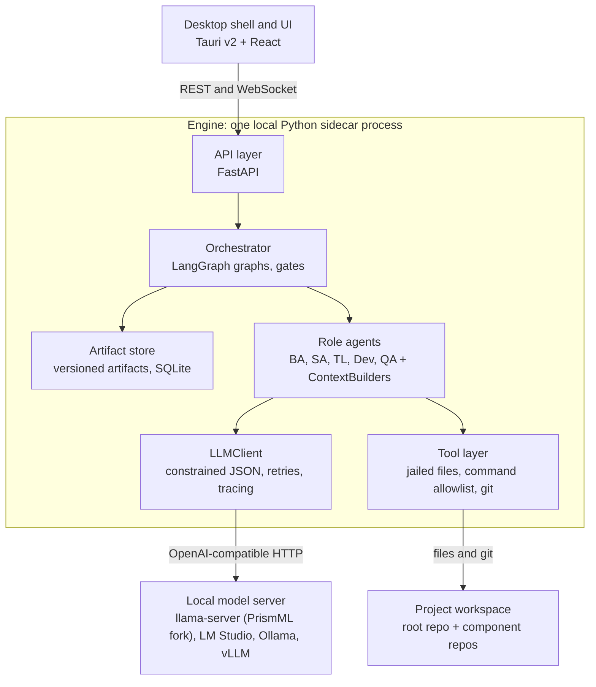
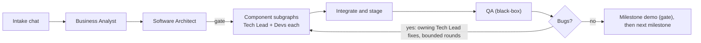

# Appsmith-CT — Implementation Specification

Last updated: 2026-11-13

## 1. Overview

Appsmith-CT is a local, cross-platform desktop application that turns a chat with the user into working software by running a simulated software company: a Business Analyst, a Software Architect, Tech Leads, developers and QA, each played by a small self-hosted LLM inside a LangGraph pipeline. This document is the build specification for Claude Code.

**Goals**

- Take a user's idea through chat, then autonomously produce requirements, an architecture, per-component specs, code, tests, integration and a QA pass.
- Make the company's information hiding real: a Dev Team knows only its own component's WHAT (inputs, outputs, contracts), never the rest of the system. The Software Architect owns the whole picture.
- Run entirely on local models, with PrismML Bonsai as the primary target, and without any cloud dependency.
- Be an experiment bench: every LLM call, retry and test result is recorded, so the user can see where small models succeed or fail, per role.

**Non-goals (v1)**

- No cloud deployment of the generated software. "Deploy" means a local staging run.
- No multi-user collaboration or accounts.
- No timeline or effort estimation. Milestones are demonstrable increments only.
- No fine-tuning. Role specialisation comes from prompts, schemas, tools and model routing.

**Guiding principles**

1. Every handoff between roles is a typed, versioned artifact (Pydantic model, also written as a readable file in the project workspace).
2. Deterministic tools are the judge. Compilers, linters and test runners decide pass or fail; an LLM reviewer only adds opinion on top.
3. Keep each LLM call small. Decompose until a task fits comfortably in a small context window.
4. Everything is checkpointed, resumable and inspectable.
5. The engine talks to models only through an OpenAI-compatible HTTP API, so any local runtime can be swapped in.
6. Role code never builds its own prompt context. A single ContextBuilder per role decides what that role may see.

## 2. Design decisions driven by small models

The pipeline assumes a small model plans poorly over long horizons but does acceptably on narrow, schema-bound steps with a small context. So complexity goes into decomposition, information hiding and tool-based verification, not into model capability.

**What Bonsai is, as of 13 Nov 2026** (from PrismML's announcements; Claude Code should re-check before pinning versions):

| Model                          | Released                | Footprint           | Notes                                                                                                                                                      |
| ------------------------------ | ----------------------- | ------------------- | ---------------------------------------------------------------------------------------------------------------------------------------------------------- |
| 1-bit Bonsai 1.7B / 4B / 8B    | 2026 (date not checked) | 8B: 1.15 GB         | Q1_0 GGUF; needs [PrismML's llama.cpp fork](https://huggingface.co/prism-ml/Bonsai-8B-gguf); CUDA, Metal, CPU                                              |
| Ternary Bonsai 1.7B / 4B / 8B  | 2026                    | 8B: 1.75 GB         | Higher benchmark average than 1-bit at the same size ([PrismML](https://prismml.com/news/ternary-bonsai))                                                  |
| Bonsai 27B (1-bit and ternary) | 14 Jul 2026             | 1-bit: about 3.9 GB | Built on Qwen3.6 27B; thinking, tool use, vision, 262K context; Apache 2.0; Apple (MLX) and NVIDIA (CUDA) ([PrismML](https://prismml.com/news/bonsai-27b)) |
| Ternary Bonsai 2 27B           | 17 Sep 2026             | not stated          | Built on Qwen3.8 27B ([PrismML](https://prismml.com/news/prismml-launches-bonsai-2-27b))                                                                   |

One caveat: a third-party report says stock llama.cpp cannot yet load the 27B hybrid-attention files, so the PrismML forks (or LM Studio, which lists the model) are the supported routes ([RunAnywhere](https://runanywhere.ai/blog/bonsai-27b-1-bit-models-on-phone)).

**Decisions**

1. The model is configuration, never a constant. A `roles.yaml` maps each role to a ModelProfile (endpoint, model name, context size, temperature, thinking on or off, tool strategy). The default setup runs Bonsai 27B (1-bit, 32K context) for every role, since it reaches about 40 tokens per second on the target machine (Ryzen 7500F, 16 GB RAM, 8 GB GPU); smaller models for lighter roles are a later change to the mapping. Profiles, the role mapping and system prompts are stored in the app database and edited in the Settings screen (section 9); shipped defaults seed the database on first run.
2. The engine speaks only the OpenAI-compatible chat API. The default target is a `llama-server` built from the PrismML fork. LM Studio, Ollama and vLLM work through the same interface. v1 does not bundle model weights or binaries; a Model Manager screen detects a running endpoint, checks it, and can launch a configured `llama-server` command.
3. Every non-code step returns schema-constrained JSON. The client passes a JSON schema to the server's constrained-decoding option, validates with Pydantic, and retries with the validation error appended.
4. Native tool calling is not assumed. Each ModelProfile selects a tool strategy: `native` (OpenAI-style tool calls) or `json_action` (the model emits one schema-constrained action object per turn: `{tool, args}` or `{done}`). Default is `json_action` for models of 8B and below and `native` for 27B.
5. Each LLM call has a context budget (default 6,000 tokens of input for developer calls). The ContextBuilder trims by priority and fails loudly rather than silently overflowing.
6. Tests, linters and type checkers produce the verdict. LLM review is advisory input to the Tech Lead, never the gate.
7. Thinking mode is a per-role setting. Default on for SA and TL planning steps, off for code generation and review summaries, because it costs latency.
8. LLM concurrency defaults to 1 and is configurable (`max_concurrent_llm_calls`), because local servers have few parallel slots.

## 3. Technology stack

Use a Python engine (LangChain and LangGraph are Python-first) running as a local sidecar process, a React UI, and a Tauri shell that packages both for Windows, macOS and Linux. Build the engine and a CLI first; the desktop shell comes last because it adds no risk to the core experiment.

| Layer          | Choice                                                                                 | Why                                                              | Alternative                                               |
| -------------- | -------------------------------------------------------------------------------------- | ---------------------------------------------------------------- | --------------------------------------------------------- |
| Desktop shell  | Tauri v2                                                                               | Small installers, native webview, first-class sidecar support    | Electron (heavier, simpler if everything were TypeScript) |
| UI             | React, TypeScript, Vite, Tailwind, React Flow for the pipeline view                    | Mature ecosystem; React Flow suits live graph status             | Svelte                                                    |
| Engine         | Python 3.12, FastAPI, uvicorn                                                          | Direct use of LangGraph and Pydantic; async; WebSocket support   | LangGraph.js in Node                                      |
| Orchestration  | LangGraph (state graphs, subgraphs, `Send` fan-out, checkpointer) and `langchain-core` | The user's stated framework; checkpointing gives resume for free | none                                                      |
| Model access   | `langchain-openai` ChatOpenAI pointed at a local base URL                              | One client for every local runtime                               | direct `httpx` client                                     |
| Schemas        | Pydantic v2                                                                            | One definition for validation, JSON schema and docs              | none                                                      |
| Persistence    | SQLite: LangGraph `SqliteSaver` plus an app database (SQLAlchemy 2, Alembic)           | Zero setup, single file per user                                 | none                                                      |
| Code workspace | Plain directories plus git repositories and submodules (GitPython or `git` subprocess) | Agents and humans share one view; branches map to tasks          | none                                                      |
| Packaging      | PyInstaller (or `uv` plus an embedded runtime) for the sidecar                         | Tauri launches it as an external binary                          | none                                                      |
| Tests          | pytest, a FakeLLM provider, Playwright for UI smoke tests                              | Deterministic CI with no GPU                                     | none                                                      |
| Tooling        | uv, ruff, mypy (strict on `engine/`), pnpm                                             | Fast and consistent                                              | none                                                      |

The app is a desktop app as the user wants. A fully local web app (engine plus browser UI) is the same code with the shell omitted, and is the development mode.

**Windows note:** sandboxed command execution (section 8) uses subprocess jails and an allowlist, not Linux namespaces, so behaviour is identical on all three operating systems. Docker is an optional extra for staging.

## 4. System architecture

The app has four parts: a UI shell, one Python engine process, a local model server and a git workspace on disk. Only the engine reaches models and files, so the UI is replaceable and the engine is testable without any window.



The UI sends commands and receives events. The engine's LLMClient and tool layer are its only gateways to the model server and the workspace.

**Repositories**

```text
asct-app/                       root repo (clone with --recurse-submodules)
  docs/                         this specification, API schemas, sample briefs
  scripts/                      setup, run-both and release helpers
  asct-fe-desktop/              submodule: React UI (src/) and Tauri shell (src-tauri/)
  asct-be-engine/               submodule: Python engine
    pyproject.toml
    appsmith/
      api/             FastAPI routers, WebSocket event stream
      core/            config, ModelProfile, LLMClient, FakeLLM, tracing, event bus
      artifacts/       Pydantic schemas, store, versioning, file export
      context/         one ContextBuilder per role (whitelists, token budgets)
      roles/           intake, ba, sa, tech_lead, developer, qa (nodes)
      graphs/          project graph, component subgraph, bugfix subgraph
      tools/           files, commands, git, http, stack profiles
      deploy/          compose and supervisor runners
      defaults/        default profiles, role mapping, prompts/, stacks/
      eval/            sample briefs and metrics harness
      cli.py           appsmith chat | run | serve | config | eval
    tests/


```

**Repository rules**

- The root repo `asct-app` holds the documentation (including this specification), shared scripts and the two submodules. Always clone it with `git clone --recurse-submodules`.
- `asct-be-engine` and `asct-fe-desktop` are independent repositories with their own CI, `CLAUDE.md` and releases. Work happens inside a submodule; afterwards the root repo's submodule pointer is updated in its own commit.
- The only coupling between the two code repositories is the engine's API. The engine exports its OpenAPI document and event schema to `asct-app/docs/api/`, and the UI generates its TypeScript client from it.
- Default model profiles, role mapping, system prompts and stack profiles ship inside the engine repo under `appsmith/defaults/`. They seed the database on first run; the UI edits the database copy (section 9).

**Process model**

- Development: `appsmith serve` runs the engine; `pnpm dev` runs the UI against it. Until M8 the product runs as a local web app in the browser; the Tauri shell is added last.
- Packaged: the Tauri shell starts the engine as a sidecar on a random port bound to 127.0.0.1, with a per-launch token, and stops it on exit.
- Per-user data (database, logs, default projects folder) lives in the OS-standard application data directory (use `platformdirs`).

**Model configuration (example `roles.yaml`; the default seeded into the database on first run; edit it later in the Settings screen)**

```yaml
profiles:
  bonsai-27b-1bit:
    {
      base_url: "http://127.0.0.1:8080/v1",
      model: bonsai-27b,
      ctx: 32768,
      tools: native,
      temperature: 0.2,
    }
roles:
  intake: { profile: bonsai-27b-1bit, thinking: true }
  ba: { profile: bonsai-27b-1bit, thinking: true }
  sa: { profile: bonsai-27b-1bit, thinking: true }
  tech_lead: { profile: bonsai-27b-1bit, thinking: true }
  dev_senior: { profile: bonsai-27b-1bit, thinking: false }
  dev_mid: { profile: bonsai-27b-1bit, thinking: false }
  dev_intern: { profile: bonsai-27b-1bit, thinking: false }
  qa: { profile: bonsai-27b-1bit, thinking: false }
limits:
  {
    max_concurrent_llm_calls: 1,
    dev_attempts: 3,
    review_rounds: 2,
    bugfix_rounds: 3,
  }
gates: [after_sa, after_milestone]
```

## 5. Agents and the LangGraph pipeline

The company process becomes four LangGraph graphs: an intake graph for the chat, a parent project graph, a component subgraph run once per component, and a bugfix loop that reuses the component subgraph. All state is checkpointed.



The whole flow below Software Architect repeats once per milestone. The approval gate after the SA is on by default; a gate after the BA is optional (section 9).

**Graphs**

1. **Intake graph.** A chat loop. Each turn the agent updates a ProjectBrief draft (goal, users, features, constraints, integrations, non-functional needs, open questions) and asks the next most useful question. It sets `ready_to_build` when open questions are resolved or the user presses "Start build".
2. **Project graph** (parent). State `ProjectState` holds the brief, requirement and milestone IDs, architecture ID, current milestone, per-component status (`pending`, `running`, `done`, `blocked`), bug round counter and gate status. Nodes: `ba`, `gate_ba`, `sa_architect`, `gate_sa`, `fan_out_components` (LangGraph `Send`, one subgraph per component), `integrate_stage`, `qa`, `triage_bugs`, `milestone_demo`, `next_milestone`.
3. **Component subgraph** (Tech Lead and developers):
   1. `tl_plan`: produce the ComponentPlan: internal architecture, code structure (files and their responsibilities) and Tasks. Parallel tasks must not own the same file. The default internal architecture is a layered backend (routes, services, domain, repositories, infrastructure) kept in `config/default_internal_architecture.md`; the Tech Lead may deviate and records why.
   2. `scaffold`: create the project skeleton from the stack profile, run it once to confirm the toolchain works.
   3. Task loop, in dependency order: `dev_implement` (agent loop with tools, writes code and its unit tests) then `run_gates` (parse, lint, type check, unit tests) then `tl_review`. A gate failure returns to the Dev with the tool output; repeated failure escalates (section 7). A review with changes returns to the Dev; approval merges the task branch.
   4. `component_e2e`: the Tech Lead writes and runs end-to-end tests against the component's contracts, using stubs for other components.
   5. `handoff`: write a ComponentReport (what was built, how to run, test results) and mark the component `done`.
4. **Bugfix loop.** `triage_bugs` assigns each BugReport to its owning component (using `suspected_component`, otherwise the SA decides from the contracts) and re-enters that component's subgraph with the bug as a Task. After the configured number of rounds, unresolved bugs are listed in the final report instead of looping forever.
5. **Milestone loop.** The project graph repeats SA (architecture delta check only after milestone 1), components, integration and QA for each milestone, then pauses at `milestone_demo`. Change requests are accepted only here: they go to the BA, then the SA re-evaluates the architecture and marks affected artifacts stale.

**Roles at a glance**

| Role                        | Question it answers                            | Main output                                             | Notes                              |
| --------------------------- | ---------------------------------------------- | ------------------------------------------------------- | ---------------------------------- |
| Intake                      | What does the user want?                       | ProjectBrief                                            | Conversational; can ask follow-ups |
| BA                          | What must the system do?                       | Requirements, Milestones                                | Never mentions technology          |
| SA                          | What parts exist and how do they talk?         | Architecture, ComponentSpecs, Contracts, staging recipe | Cares about WHAT, not HOW          |
| Tech Lead                   | How is this component built and is it good?    | ComponentPlan, reviews, e2e tests                       | Owns internal architecture         |
| Developer (Intern, SE, SSE) | Does this task's code work?                    | Code and unit tests                                     | Seniority picks the model profile  |
| QA                          | Does the running system meet the requirements? | TestPlan, BugReports                                    | Black-box only                     |

**SA decision order** (a fixed checklist replaces "pulling the architecture out of thin air"; the prompt walks the model through it one step at a time):

1. List domain entities, key events and external systems from the requirements (a light DDD pass).
2. Choose the style. Default to a frontend plus a backend. Split the backend into two or three services only when the requirements show independent domains or clearly different load. A standalone desktop product becomes a modular monolith with module boundaries instead of services.
3. Define one Contract per boundary: the data in and out, how it travels (REST, queue, event, function call) and whether it is persisted.
4. Pick a stack per component from `config/stacks/*.yaml`, honouring the user's stated preferences.
5. Define the deployment recipe.
6. Write each ComponentSpec with a testable `definition_of_done`, giving a component only the requirements and contracts it needs.
7. Run the architecture validator (no uncovered requirement, no unknown contract reference, no dependency cycle); on failure, revise with the validator's messages.

## 6. Artifacts and data contracts

Roles communicate only by producing typed artifacts. Each artifact is a Pydantic model, stored in the app database with a version number and also exported as a readable file in the project workspace. A role's prompt is assembled by its ContextBuilder from a fixed whitelist of artifacts, which is how the company's information hiding is enforced.

| Artifact                                                          | Produced by   | File in `docs/`             | Read by                                                              |
| ----------------------------------------------------------------- | ------------- | --------------------------- | -------------------------------------------------------------------- |
| ProjectBrief                                                      | Intake chat   | `brief.json`                | BA                                                                   |
| Requirements (functional, with acceptance criteria)               | BA            | `requirements.json`         | SA, QA, Tech Leads (only the requirements linked to their component) |
| Milestones                                                        | BA            | `milestones.json`           | SA, orchestrator                                                     |
| Architecture (style, components, stack, deployment, decision log) | SA            | `architecture.json`         | SA, integration steps                                                |
| ComponentSpec                                                     | SA            | `components/<id>/spec.json` | That component's Tech Lead only                                      |
| Contract (OpenAPI, event schema, queue topic)                     | SA            | `contracts/<id>.*`          | Tech Leads of the producing and consuming components only            |
| ComponentPlan (internal design, code structure, tasks)            | Tech Lead     | `components/<id>/plan.json` | That Tech Lead and Devs on the component                             |
| ReviewReport, IntegrationReport                                   | Tech Lead, SA | `runs/`                     | Producer and SA                                                      |
| TestPlan and BugReport                                            | QA            | `qa/`                       | SA, then the owning Tech Lead (bug only)                             |
| ChangeRequest                                                     | User, via BA  | `changes/`                  | BA, SA                                                               |

**Who sees what**

| Role      | Sees                                                                              | Never sees                                         |
| --------- | --------------------------------------------------------------------------------- | -------------------------------------------------- |
| BA        | Brief, chat history, change requests                                              | Architecture, code                                 |
| SA        | Requirements, milestones, architecture, all contracts, integration and QA reports | Component internals, except test and build results |
| Tech Lead | Own ComponentSpec, own contracts, linked requirements, own code                   | Other components' specs and code                   |
| Developer | One Task, relevant contract excerpts, plan excerpt, code files named by the task  | Everything else                                    |
| QA        | Requirements, running staging system, public API contracts                        | Source code                                        |

The isolation rule is tested: a unit test per ContextBuilder asserts that the built prompt contains no text from artifacts outside its whitelist.

**Core schemas** (Pydantic v2; fields beyond these are allowed, but these are the contract):

```python
class Artifact(BaseModel):
    id: str; version: int; produced_by: str   # role id
    created_at: datetime; parent_ids: list[str] = []

class Requirement(BaseModel):
    id: str                      # FR-001
    title: str; description: str
    acceptance_criteria: list[str]   # each independently testable
    priority: Literal['must', 'should', 'could']
    milestone_id: str

class Milestone(BaseModel):
    id: str; title: str
    demo_description: str        # what the user can see working
    requirement_ids: list[str]

class Contract(BaseModel):
    id: str; kind: Literal['rest', 'event', 'queue', 'function']
    producer: str; consumers: list[str]   # component ids
    schema_ref: str              # file path to OpenAPI or JSON Schema
    delivery: str                # how data arrives or leaves, plain words
    persistence: bool

class ComponentSpec(BaseModel):
    id: str; name: str; responsibility: str
    kind: Literal['frontend', 'backend_service', 'library', 'monolith_module']
    inputs: list[str]; outputs: list[str]   # contract ids
    requirement_ids: list[str]
    stack: StackChoice           # language, framework, test tool, run command
    definition_of_done: list[str]
    architecture_rules: list[str] = []   # for monolith modules

class Task(BaseModel):
    id: str; component_id: str; title: str
    description: str; files: list[str]    # files to create or change
    difficulty: Literal['easy', 'medium', 'hard']
    depends_on: list[str] = []
    acceptance: list[str]        # testable, includes unit tests to write

class BugReport(BaseModel):
    id: str; severity: Literal['blocker', 'major', 'minor']
    requirement_id: str | None; steps: list[str]
    expected: str; actual: str; evidence: str   # log or response excerpt
    suspected_component: str | None
```

**Versioning.** An artifact is immutable once written; a change produces a new version. When an upstream artifact changes (a requirement edit at a gate, say), every downstream artifact built from it is marked `stale` and the orchestrator re-runs only those nodes.

## 7. Small-model reliability techniques

Every node follows the same pattern: build a small context, call the model for schema-bound output, validate, check with tools, and escalate only after bounded retries. These rules are part of the engine, not of any one role.

1. **LLMClient.** One wrapper exposes `generate_structured(schema, messages, profile)` and `run_agent_loop(tools, goal, profile)`. It applies constrained decoding, validates with Pydantic, and on failure retries with the error appended (default 3 attempts). Persistent failure raises `StepFailed`, which the graph handles instead of crashing.
2. **Escalation ladder.** Developer seniority maps to model profiles: Intern, SE, SSE, then the Tech Lead's profile. A task that fails its attempts moves up one rung. After the top rung the Tech Lead re-plans the task (split it or rewrite its description). After two re-plans the task is marked `blocked` and goes to the SA.
3. **Bounded loops.** Defaults: 15 steps per agent loop, 3 dev attempts per task, 2 review rounds per task, 3 bug-fix rounds per milestone. All are config values. Repeated identical actions abort the loop.
4. **Code edit protocol.** Small models write unreliable diffs. Files up to 200 lines are written whole. Larger files use SEARCH/REPLACE blocks that the engine applies and checks (the search text must match exactly once). Unified diffs are not used.
5. **Context assembly.** The ContextBuilder sends the task, the contract excerpts it needs, and file contents for files the task names. Other files in the component appear as outlines (paths and signatures). It enforces the token budget by dropping lowest-priority items first and logs what was dropped.
6. **Prompts as files.** Each role has `defaults/prompts/<role>/system.md.j2`, per-step templates and a few worked examples, shipped as defaults, copied into the database on first run and editable in the Settings screen. User edits override the defaults and can be reset; each saved prompt gets a version number. Prompt version is recorded on every LLM call.
7. **Ground-truth gates.** A task is done only when its files parse, the linter and type checker pass, and its unit tests (written by the same Dev as part of the task) pass. Only then does the Tech Lead review.
8. **Tech Lead review** is an LLM step that sees the diff, the task, the tool results and the contract excerpts, and returns `approve` or `changes` with concrete items. Approval without a green gate is rejected by the engine.
9. **Checkpointing and resume.** Every graph uses the SQLite checkpointer. Nodes are idempotent: they write artifacts atomically and skip work when a valid artifact of the right version exists. The user can stop the app and resume the run.
10. **Full tracing.** Every call is stored in `llm_calls` with run, node, role, profile, prompt version, full prompt, full response, token counts, latency, validation outcome and retry index.
11. **Experiment metrics.** The engine computes per run and per role: first-attempt validation rate, task pass rate on first attempt, retries, escalations, tokens, wall time. The UI shows them and exports CSV.
12. **Determinism.** Low temperature by default; seeds are recorded where the runtime supports them.

## 8. Workspace, tools and execution

Each project is a root git repository with one submodule repository per component, all on disk where agents and the user can see them. Agents act only through a small tool layer that enforces per-role permissions.

```text
~/AppsmithCT/projects/<slug>/      project root repo
  docs/            brief, requirements, milestones, architecture, contracts/, components/<id>/
  <component>/       submodule: its own repository, one per component
  qa/              black-box tests written by QA
  deploy/          staging recipe (compose file or run script), health checks
  runs/            review and integration reports, exported traces
  .appsmith/       project settings and SQLite files (git-ignored)
```

**Tools**

| Tool                                          | Available to                                                                       | Rules                                                                                                                                                                        |
| --------------------------------------------- | ---------------------------------------------------------------------------------- | ---------------------------------------------------------------------------------------------------------------------------------------------------------------------------- |
| `read_file`, `list_dir`, `search_text`        | Dev, TL (jailed to `<component>/`); SA (whole repo); QA (`qa/` and `deploy/` only) | Paths are resolved and rejected if they escape the jail                                                                                                                      |
| `write_file`, `apply_edit`                    | Dev (own task's files), TL (own component), QA (`qa/`), SA (`docs/`, `deploy/`)    | Edits are applied, then re-read to confirm                                                                                                                                   |
| `run_command`                                 | Dev, TL, SA, QA                                                                    | Allowlist per stack profile (for example `pytest`, `ruff`, `mypy`, `npm test`, `tsc`); timeout; output truncated to a budget; scrubbed environment; working directory jailed |
| `git_*` (status, diff, commit, branch, merge) | Dev (commit on own branch), TL (merge), SA (tag, integration branch)               | Wrapped, not raw shell                                                                                                                                                       |
| `http_request`                                | QA, SA                                                                             | Only to staging URLs the deploy recipe declares                                                                                                                              |

**Git flow.** Each component is its own repository and a submodule of the project root repository. Each task gets a branch `task/<task-id>` in that component's repository, and the Dev commits there. After the gates pass and the Tech Lead approves, the engine merges to `main` with a squash commit. Because components do not share a working tree, several Dev Teams can later work on different components at the same time, and conflicts can only occur inside one component; when one does, the Tech Lead gets a conflict-resolution step. The SA tags `milestone-<n>` in every repository and records the matching submodule commits in the root repository, so each milestone is reproducible. A monolith project is a single repository with one directory per module and no submodules; branch and merge rules are the same.

**Staging.** The SA produces a `deploy/` recipe. If Docker is detected, it is a compose file; otherwise a supervisor script starts each component as a local process and polls its health endpoint. A staging report records what started, what failed and the logs.

**Safety caveat.** The allowlist, path jail and timeouts reduce accidents but do not form a security sandbox. Generated code runs on the user's machine. The UI shows this on first run, and a project setting runs all commands inside a container when Docker is available. This setting should be implemented in milestone 5 and recommended as the default.

## 9. UI and UX

The UI is an observer and controller of engine runs; it never calls a model directly. It talks to the engine over REST for data and a WebSocket for the live event stream.

**Screens**

1. **Projects.** Create, open and delete projects; pick the workspace folder.
2. **Chat.** The intake agent asks questions and keeps a live ProjectBrief panel beside the chat. A "Start build" button freezes the brief and starts the run.
3. **Pipeline.** A React Flow view of the project graph and component subgraphs. Nodes show status (waiting, running, done, failed, blocked), attempts and elapsed time. Clicking a node shows its input artifacts, output artifacts and LLM calls.
4. **Artifacts.** Rendered requirements, architecture and component specs with version history, diff between versions, and stale markers.
5. **Workspace.** File tree, syntax-highlighted viewer, branch list, per-task diffs, test and lint results.
6. **Runs and metrics.** Per-role tables of tokens, retries, escalations and pass rates; an LLM call inspector with full prompt and response; CSV export.
7. **Settings.** Model profiles (endpoint, model name, context size, temperature, tool strategy), role-to-profile mapping with a per-role thinking switch, editable system prompts per role with reset to default, limits, gates, stack preferences, and a "test connection" button per profile. All model configuration lives in the database and is edited here; shipped defaults seed it on first run, and an edit applies from the next run, never to a run in progress.

**Controls.** Pause, resume, stop; retry a node; restart from a chosen node (LangGraph checkpoint history); edit an artifact file at a gate, then resume.

**Human gates.** Configurable stops where the run waits for approval: `after_ba`, `after_sa`, `after_milestone`. Default is on for `after_sa` and `after_milestone`. At a gate the user may edit the artifact; edits create a new version and mark downstream artifacts stale.

**Engine API (summary)**

| Endpoint                                                   | Purpose                                                                                                   |
| ---------------------------------------------------------- | --------------------------------------------------------------------------------------------------------- |
| `POST /projects`, `GET /projects/{id}`                     | Project lifecycle                                                                                         |
| `WS /projects/{id}/chat`                                   | Streaming intake conversation                                                                             |
| `POST /projects/{id}/runs`                                 | Start a build from the frozen brief                                                                       |
| `POST /runs/{id}/control`                                  | pause, resume, stop, retry node, restart from node, approve gate                                          |
| `WS /runs/{id}/events`                                     | Typed events: node started and finished, LLM call, tool call, artifact written, gate reached, metrics     |
| `GET /runs/{id}/artifacts`, `GET /artifacts/{id}/versions` | Artifact access                                                                                           |
| `GET /runs/{id}/llm-calls`, `GET /runs/{id}/metrics`       | Inspection and metrics                                                                                    |
| `GET/PUT /settings/models`                                 | Profiles, role mapping and thinking switch; system prompts under /settings/prompts, with reset to default |

## 10. Implementation milestones for Claude Code

Build in this order. Each milestone ends with a demonstrable result and passing tests; do not start the next until the acceptance checks hold. Every milestone must keep the FakeLLM test suite green, so CI never needs a GPU.

1. **M0: Skeleton.** Create the three repositories (asct-app as root, with asct-be-engine and asct-fe-desktop as submodules; layout in section 4), uv in the engine and pnpm in the UI, lint and type-check config, CI per repository, and a root script that runs both. FastAPI app with `/health`. Acceptance: `uv run pytest` and `pnpm build` pass on a fresh recursive clone of asct-app.
2. **M1: Engine foundation.** Config loader (`roles.yaml`, ModelProfile), LLMClient with constrained JSON output, validation and retry, FakeLLM provider, SQLite models and migrations, settings tables for model profiles, role mapping and system prompts seeded from the shipped defaults, an appsmith config command to read and write them until the UI exists, event bus, `llm_calls` tracing, artifact store with versions and file export, ContextBuilder base class. Acceptance: a test runs a two-node LangGraph with FakeLLM, writes a versioned artifact, resumes after a simulated crash, and records every call; a manual script does the same against a real local endpoint.
3. **M2: Intake and BA.** Intake chat graph that maintains a ProjectBrief and decides when it has enough to offer "Start build"; BA graph producing Requirements and Milestones with traceable IDs. CLI: `appsmith chat`, `appsmith run --stop-after ba`. Acceptance: on three sample briefs, the output validates, every requirement has at least one acceptance criterion, and every requirement belongs to exactly one milestone.
4. **M3: Software Architect.** SA graph producing Architecture, ComponentSpecs, Contracts and stack choices, with a default decision order (see section 5) and a validator that rejects dangling references, uncovered requirements and cyclic dependencies. Acceptance: validator tests pass; on the sample briefs every requirement maps to a component, and each ComponentSpec's ContextBuilder output excludes other components' specs.
5. **M4: Component subgraph.** Tool layer (jailed files, command allowlist, git), creation of one repository per component plus the project root repository with submodules (a single repository for a monolith), TL planning (internal design, tasks), Dev loop with escalation ladder, gates, TL review, merge, component end-to-end tests. Acceptance: one backend component of a sample brief is built unattended with a real model; with FakeLLM, tests cover retry, escalation, blocked-task and merge-conflict paths.
6. **M5: Integration, staging and QA.** Parallel component fan-out, integration checks against contracts, staging deploy (compose or supervisor), QA agent writing black-box tests from requirements, bug triage back to Tech Leads, bounded fix rounds, container execution option. Acceptance: a two-component sample (backend plus frontend) reaches "ready" or a clear failure report.
7. **M6: API and UI.** Full REST and WebSocket API from section 9, then the seven screens, with model profiles, role mapping and system prompts fully editable in Settings. Acceptance: a Playwright smoke test drives chat, gate approval and run inspection against a FakeLLM engine.
8. **M7: Milestone loop and change requests.** Run milestones in order, demo pause after each, accept change requests only at milestone boundaries, re-run the SA on architecture impact and only the affected components. Acceptance: a change request on milestone 1 output produces a new architecture version and re-runs only stale nodes.
9. **M8: Packaging and evaluation.** Tauri shell with sidecar lifecycle, installers for the three operating systems, Model Manager screen, evaluation harness (`appsmith eval`) running a fixed set of briefs (for example a to-do web app, a URL shortener, an inventory system) and reporting pass rate by role and model profile. Acceptance: the installer launches the app, which connects to a local model; `appsmith eval` produces a metrics CSV.

## 11. Risks, open questions and future work

The largest risk is that small models fail at the Software Architect step, because architecture quality drives everything after it. The design lowers that risk with a fixed decision order, a validator and a human gate, and the experiment will show whether it is enough.

**Risks**

- **Architecture quality.** Mitigation: the SA prompt carries a default decomposition (frontend, one to three backend services, shared contracts) and a checklist; the validator checks structure; the user reviews at `after_sa`.
- **Interface drift.** Teams that cannot see each other may implement contracts differently. Mitigation: contracts are machine-readable, and integration runs contract tests built from them.
- **Throughput.** A local GPU serves few parallel requests, so a full build may take hours. Mitigation: checkpointing, a default concurrency of one, and per-role model sizing.
- **Runtime churn.** The Bonsai file formats need PrismML's forks, which may change. Mitigation: only the OpenAI-compatible API is a hard dependency; runtime details live in the Model Manager.
- **Running generated code.** See the safety caveat in section 8.

**Confirmed by the user, and one open point**

- Models: Bonsai 27B at 1-bit with a 32K context window, running at about 40 or more tokens per second on a Ryzen 7500F, 16 GB RAM and a 5060 Ti with 8 GB. It serves every role at first; smaller models for lighter roles come later.
- First stacks: Python with FastAPI for backends, TypeScript with React for frontends.
- A local web mode (engine plus browser) is acceptable until M8.
- Repositories: `asct-app` (root) with `asct-be-engine` and `asct-fe-desktop` as submodules; generated projects follow the same pattern.
- Model configuration, including system prompts, is edited in the UI.
- Open: whether developers get syntax-aware code tools (read a symbol, replace a symbol) instead of generic file writes. Decide after M4, using the retry and syntax-error metrics.

**Future work**

- Learn from failed runs: store accepted fixes as few-shot examples per role.
- Optional frontier-model escalation for a single role, behind an explicit setting and off by default.
- Additional roles: DevOps, security reviewer, technical writer.
- Support for rewriting or upgrading an existing codebase (a reverse-engineering BA step), which the user's original company workflow also covered.
